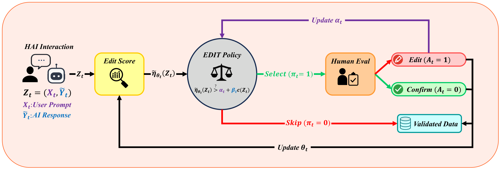
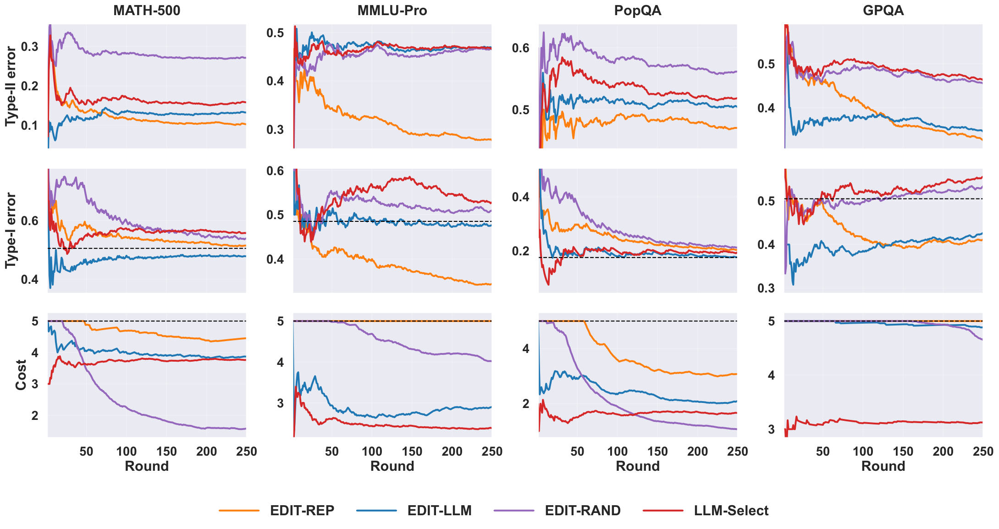
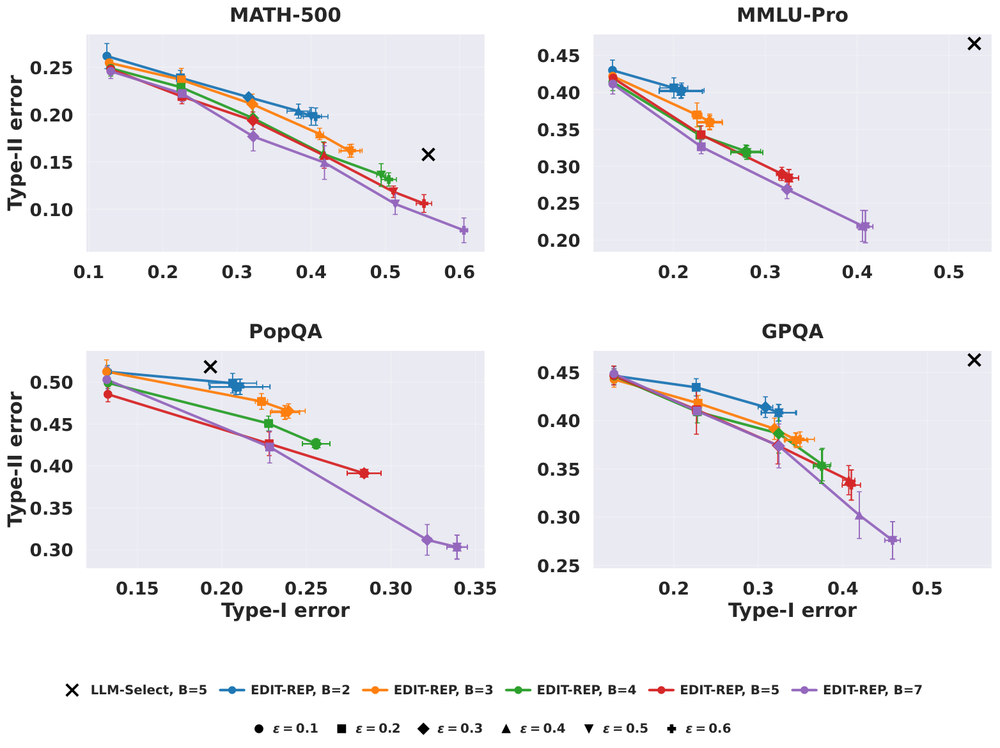
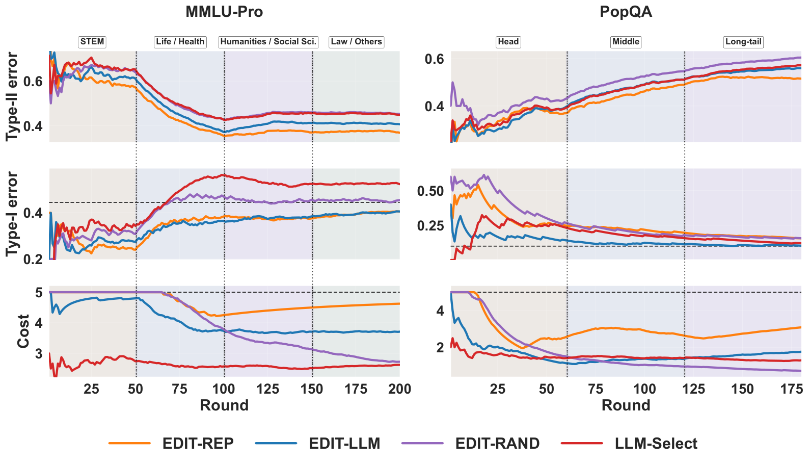
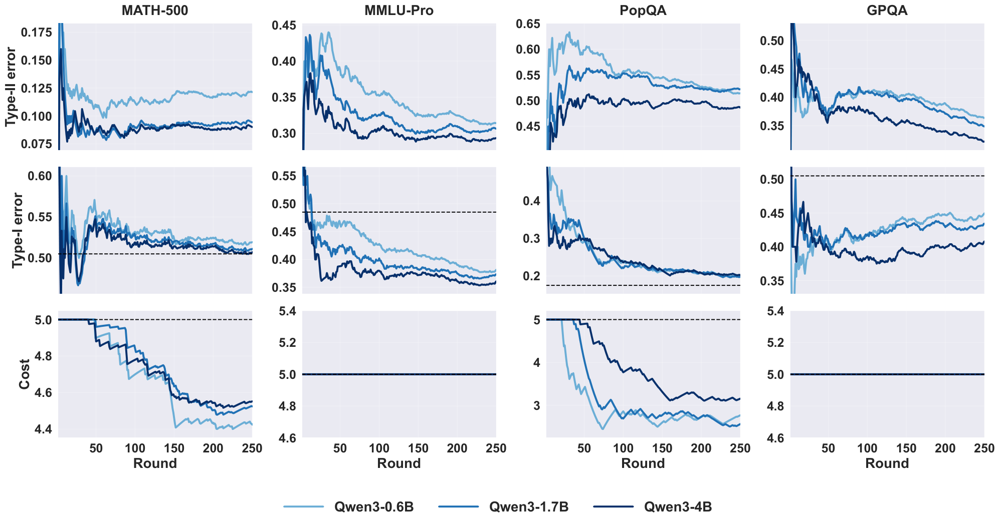

# Edit Discovery in Human–AI Interactions

Code for the paper [**Edit Discovery in Human–AI Interactions**](https://arxiv.org/pdf/2610.22661).

Many AI responses in a human–AI interaction log are already fine, while others expose failures that become valuable supervision once an *editor* corrects them. The editor can be a human expert, a stronger model, or the same model with more compute or tools. Invoking the editor is costly, so the question is which interactions to send to it before knowing whether an edit will be made.

We formulate this as **Edit Discovery Optimization (EDO)**. The goal is to minimize the edits missed among skipped interactions (Type-II error) while controlling the confirmations among selected ones (Type-I error) under an editor budget. The population-optimal policy is a cost-adjusted threshold on the posterior edit probability. **EDIT** (Edit Discovery via Iterative Thresholding) is an online algorithm for the partial-feedback setting, where labels are revealed only for selected interactions. It has three parts:

- an adaptive edit score;
- a confirmation-control threshold `α_t`;
- a cost-aware selection rule.

EDIT respects the budget at every round and controls the average confirmation rate without distributional assumptions.

<p align="center"></p>

## Installation

```bash
pip install -r requirements.txt
export OPENROUTER_API_KEY=...
```

LLM calls go through [OpenRouter](https://openrouter.ai). GPQA is gated on Hugging Face, so accept its terms and run `huggingface-cli login` first.

## Running experiments

Each YAML file in `configs/<model>/<setting>/` is one run, and `<model>` is `llama` or `qwen`. The settings are:

- main experiments: `math500`, `mmlupro`, `popqa`, `gpqa`;
- response-length-aware costs (Llama only): `math500_review_length`, `gpqa_review_length`;
- distribution shift (Llama only): `mmlupro_shift`, `popqa_shift`.

```bash
python main.py --config configs/llama/math500/edit_rep.yaml
python main.py --config configs/llama/math500/*.yaml
for d in configs/*/*; do python main.py --config $d/*.yaml; done
```

The first run of a model and dataset generates and caches the response-model answers for the whole pool in `outputs/<model>_<dataset>/gen_*.csv`. All methods then reuse the same responses and the same stream of batches. Each run writes a per-interaction CSV and a state file to `outputs/`, so an interrupted run resumes where it stopped. Use `--reset` to start over.

The encoder-size study uses the `edit_rep_qwen3-*.yaml` configs in `configs/llama/{math500,mmlupro,popqa,gpqa}`.

## Reproducing figures and tables

```bash
python tables.py
python plots.py
python pareto.py
```

- `tables.py` prints response-model accuracies and the discovery metrics: running-average Type-I/II errors and cost, plus edit recall, missed edits and edit precision.
- `plots.py` writes the paper figures to `figures/`.
- `pareto.py` re-runs EDIT-REP offline on the cached responses over ε ∈ {0.1, …, 0.6}, B ∈ {2, 3, 4, 5, 7} and 5 stream seeds, then plots the operating-point trade-offs. It calls no LLM.

## Human audit

```bash
python audit/server.py
```

This opens a local annotation interface for the 200 audit interactions in `audit/samples.csv`, 50 per dataset. Each annotator's labels are saved to `audit/annotations/<name>.csv`.

## Methods

| Method | `method` | Edit score / selection rule |
|---|---|---|
| **EDIT-REP** | `edit_rep` | Online logistic probe on frozen embeddings (all-MiniLM-L6-v2, or Qwen3-0.6B/1.7B/4B) |
| **EDIT-LLM** | `edit_llm` | Edit probability estimated by prompting an LLM |
| **EDIT-RAND** | `edit_rand` | Uniform random score (ablation of the edit score) |
| **LLM-Select** | `llm_select` | An LLM directly picks the items of each batch to review under the budget |
| Random | `random` | Random selection under the budget |

All EDIT variants share the same thresholding and budgeted selection rule. They differ only in the edit score (`src/methods/edit.py`).

## Results

The editor label is task correctness, and the response models are Llama-3.3-70B-Instruct and Qwen3-32B. The benchmarks are MATH-500, MMLU-Pro, PopQA and GPQA. Each run uses `T = 250` rounds of `n_t = 10` interactions and an editor budget of `B_t = 5`. A human audit of 200 interactions confirms that correctness tracks real edit decisions: 96.5% agreement, Cohen's κ = 0.930.

<p align="center"></p>
<p align="center"><em>Running-average Type-II error, Type-I error and editor cost with Llama-3.3-70B-Instruct. Dashed lines mark ε and the per-round budget.</em></p>

Edit recall / missed edits / edit precision on the main Llama-3.3-70B-Instruct runs:

| Method | MATH-500 | MMLU-Pro | PopQA | GPQA |
|---|---|---|---|---|
| EDIT-REP | **0.784** / **143** / 0.467 | **0.703** / **346** / **0.656** | **0.411** / **824** / 0.746 | **0.644** / **407** / **0.589** |
| EDIT-LLM | 0.691 / 205 / **0.473** | 0.292 / 826 / 0.469 | 0.284 / 1002 / **0.756** | 0.615 / 440 / 0.576 |
| EDIT-RAND | 0.151 / 563 / 0.253 | 0.401 / 699 / 0.466 | 0.109 / 1246 / 0.571 | 0.472 / 604 / 0.464 |
| LLM-Select | 0.621 / 251 / 0.437 | 0.238 / 889 / 0.465 | 0.223 / 1087 / 0.752 | 0.306 / 793 / 0.448 |

Sweeping ε and the budget B traces the Type-I/Type-II operating points of EDIT-REP, averaged over 5 streams. The black cross is LLM-Select at B = 5, and lower is better on both axes.

<p align="center"></p>

EDIT stays effective under distribution shift: MMLU-Pro subject blocks, and PopQA moving from head to long-tail entities.

<p align="center"></p>

Larger frozen encoders improve EDIT-REP further:

<p align="center"></p>

## Citation

```bibtex
@article{mirrokni2026edit,
  title   = {Edit Discovery in Human--AI Interactions},
  author  = {Mirrokni, Alireza and Kiyani, Shayan and Pappas, George and Hassani, Hamed},
  journal = {arXiv preprint arXiv:2610.22661},
  year    = {2026}
}
```
